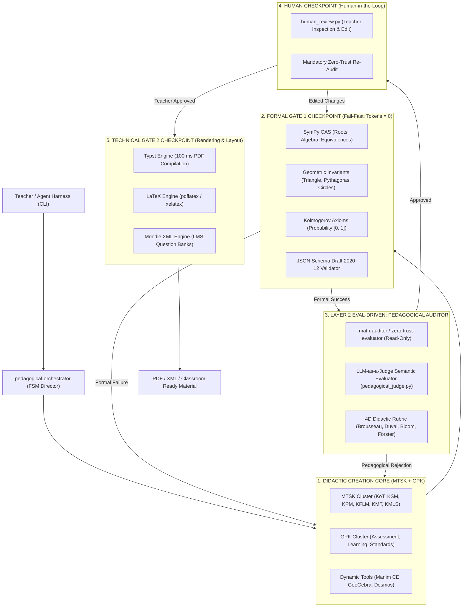

# AGENTS.md - math-teaching-agents Ecosystem (v0.8.0)

> **Single Source of Truth** for didactic design, formal neural-symbolic verification, and pedagogical auditing of learning sequences and assessment instruments in secondary and higher mathematics education.
> Natively compatible with **Google Antigravity**, **Claude Code**, **Cursor**, **Aider**, and terminal CLI environments across all operating systems.

---

## 1. System Architecture (Universal Meta-Standard)

The system operates under a **distributed Actor-Critic architecture with hybrid neural-symbolic verification in two sequential checkpoints (Two-Stage Fail-Fast Gatekeeper)**:



---

## 2. Phase 0: Teacher Intake Interview Protocol

Before convening the Creation Cluster or drafting any material, the `pedagogical-orchestrator` **MUST** calibrate the request with the teacher.

If the user's initial instruction does not specify all key pedagogical parameters (and they are not configured in `.math-agent.yaml`), the agent **does not make blind assumptions**; instead, it conducts a concise intake dialog asking:

1. **School / Educational Institution**: Institutional context or student cohort profile.
2. **Grade Level / Course**: Target grade (e.g., Grade 8, Grade 10, High School, Undergraduate).
3. **Curricular Domain / Strand**: Mathematical domain (e.g., *Numbers & Operations*, *Algebra & Functions*, *Geometry*, *Statistics & Probability*).
4. **Concrete Mathematical Topic & Skill/Objective**: Precise scope (e.g., *Quadratic Functions*, *Pythagorean Theorem*, *Hypothesis Testing*).
5. **Desired Didactic Framework or Theoretical Stance**:
   - **TDS (Brousseau)**: Action, Formulation, Validation, and Institutionalization phases.
   - **OSA / EOS (Godino et al.)**: Onto-semiotic configurations, semiotic conflicts, and Didactic Suitability.
   - **APOS (Dubinsky)**: ACE Cycle and Genetic Decomposition (Action $\to$ Process $\to$ Object $\to$ Schema).
   - **TRRS (Duval)**: Active coordination and conversion across registers (graphical, algebraic, tabular, verbal).
   - **RME (Freudenthal)**: Horizontal and vertical mathematization in realistic contexts.
   - **Pragmatic / Applied**: Direct classroom application without heavy theoretical terminology.
   - *(Any custom framework provided by the user is accommodated and dynamically synthesized Just-in-Time).*
6. **Resource Type and Output Target**: Guided inquiry worksheet, problem situation, summative exam, Manim CE animation, GeoGebra applet, or Moodle XML question bank.

---

## 3. Specialized Subagent Catalog

### A. MTSK Disciplinary Cluster (`agents/mtsk/`)
Exhaustive modeling of the Mathematics Teacher's Specialized Knowledge (Carrillo et al., 2018):
* **`mtsk-kot`**: Knowledge of Topics (formal definitions, mathematical properties, procedures).
* **`mtsk-ksm`**: Knowledge of the Structure of Mathematics (connections, prerequisites, horizon).
* **`mtsk-kpm`**: Knowledge of Practices in Mathematics (proof, argumentation, conjecture).
* **`mtsk-kflm`**: Knowledge of Features of Learning Mathematics (cognitive obstacles, common misconceptions).
* **`mtsk-kmt`**: Knowledge of Mathematics Teaching (didactic strategies, metaphors, representations).
* **`mtsk-kmls`**: Knowledge of Mathematics Learning Standards (alignment with national curricula and international benchmarks: IB, PISA, NCTM).

### B. GPK General Pedagogical Cluster (`agents/gpk/`)
* **`gpk-assessment`**: Psychometric validity, Anderson-Krathwohl taxonomy, formative assessment (*Förster, Wiliam, Brookhart*).
* **`gpk-learning`**: Learning theories (Vygotsky ZPD, Piaget, Universal Design for Learning / CAST).
* **`gpk-standards`**: Institutional curriculum policies and cross-curricular competencies.

### C. Dynamic and Multimodal Tools Cluster (`agents/dynamic-tools/`)
* **`manim-motion-engineer`**: Python cinematic vector animations using Manim Community Edition.
* **`geogebra-desmos-engineer`**: Interactive geometric and algebraic applets.
* **`interactive-web-widget-engineer`**: Interactive HTML5 / Canvas components for web-based classrooms.

### D. Pedagogical Auditor Subagent (`agents/evaluator.md` / `math-auditor`)
* **Principle of Least Privilege (Read-Only)**: Strict read-only file permissions (`tools: [read_file]`). Prohibited from editing files directly to prevent superficial patching instead of dialectical correction.
* **Immediate Rejection Triggers**: Topaze Effect detection (Brousseau), absence of multi-register conversion (Duval), or purely mechanical low-level cognitive demand.
* **Structured XML Verdict Protocol**:
  ```xml
  <audit_report status="APPROVED|REJECTED" cycle="1/2">
    <score_bloom>Achieved cognitive depth</score_bloom>
    <multiregister_check>Duval semiotic register evaluation</multiregister_check>
    <didactic_effects>Vigilance against Topaze / Jourdain didactic effects</didactic_effects>
    <required_actions>
      <action priority="high|medium">Mandatory concrete remediation</action>
    </required_actions>
  </audit_report>
  ```
* **Stopping Criteria**: Maximum 2 remediation cycles between Creator and Auditor. If rejection persists, escalates to the Human Checkpoint (HITL).

---

## 4. Mandatory Deterministic Checkpoints (Zero Hallucination)

> [!CRITICAL]
> **Prohibition of Stochastic Calculation**: The AI is strictly forbidden from computing roots, algebraic factorizations, or numeric solutions from memory.
> Deterministic CLI tools MUST be invoked via terminal:
> 1. `python tools/verify_math.py --solve "<equation>" --json`
> 2. `python tools/verify_math.py drafts/my_assessment.yaml --json`
> 3. `python tools/validate.py drafts/my_assessment.yaml --json`
> 4. `python tools/render.py drafts/my_assessment.yaml --format typst --compile --json`

---

## 5. Canonical Skills Available (`.agents/skills/`)

* **`math-didactic-unit`**: Lesson sequences and learning situations structured into Brousseau's 4 phases (Action, Formulation, Validation, Institutionalization), Duval registers, and APOS Theory.
* **`math-assessment`**: Authentic assessment design with formally verified cognitive distractors (*Socas, De Bock*), observable rubrics, and Moodle XML export.
* **`math-dynamic-visualizer`**: Dynamic mathematics visual animations with Manim and GeoGebra constructions.

---

## 6. Immediate Validation Checks ("Checks to Run")

Before finishing any session or artifact in the repository:
```bash
# 1. Run complete unit test suite (76 tests passing):
pytest tests/

# 2. Validate schemas and curriculum frameworks:
python tools/validate.py --all

# 3. Verify a specific draft:
python tools/verify_math.py drafts/example.yaml --json
```
