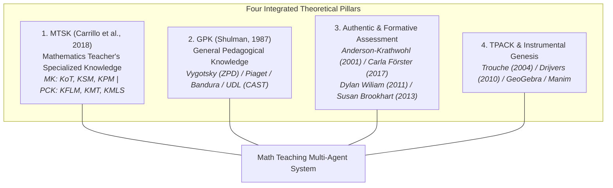
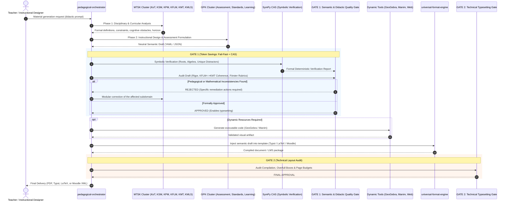

# Multi-Agent System for Mathematics Teaching & Didactic Engineering
### Open-Source Multi-Agent Framework for Didactic Design, Authentic Assessment, and Mathematics Pedagogy

[](LICENSE)
[](https://www.python.org/)
[](pyproject.toml)
[](#3-workflow-architecture-fsm)
[](CLAUDE.md)
[](#4-zero-symbolic-hallucination-gate-1)
[](#5-compilation-to-typst-latex--moodle-gate-2)
[](tests/)

---

## 1. Overview and Purpose

This repository houses the architecture, declarative specifications, and executable engine of an **intelligent, rigorous, fully decoupled multi-agent system** engineered for mathematics pedagogy, didactic engineering in secondary and higher education, and the generation of authentic assessment instruments with psychometric and formative validity.

Moving beyond monolithic "conversational chat assistants", this system adopts a **distributed Actor-Critic architecture with hybrid neural-symbolic verification**:

* **Absolute Decoupling:** Strict barrier between *mathematical content knowledge*, *instructional design / didactic engineering*, *assessment standards*, *dynamic visualization artifacts*, and *typography / typesetting compilation engines*.
* **Two-Stage Fail-Fast Gatekeeper with CAS:** Zero token waste. A ruthless evaluation agent audits the neutral semantic draft (**Gate 1**), powered by a formal symbolic engine (**SymPy**) verifying roots, derivatives, invariants, and unique cognitive distractors before any typesetting compilation is triggered (**Gate 2**).
* **Portability & Curriculum Neutrality:** Works with declarative curriculum adapters for international frameworks (IB, PISA, NCTM) and regional standards (Spain LOMLOE, Chile MINEDUC, Mexico NEM, Colombia MEN), allowing educators to plug in their own institutional templates and theoretical models.

---

## 2. Theoretical Foundations

The system is built upon foundational, peer-reviewed models in mathematics education and pedagogy research:



---

## 3. Workflow Architecture (FSM)



---

## 4. Quickstart

### Prerequisites
* Python 3.10 or higher.

### A. For AI Agents in Terminal Harnesses (Claude Code, OpenCode, Antigravity)
Subagents invoke deterministic CLI tools in `tools/` via terminal (see [`CLAUDE.md`](CLAUDE.md) and [`tools/README.md`](tools/README.md)):

```bash
# 1. Validate JSON schema compliance (Draft 2020-12):
python tools/validate.py drafts/my_assessment.yaml --json

# 2. Audit mathematical roots and distractor uniqueness with SymPy CAS (Gate 1):
python tools/verify_math.py drafts/my_assessment.yaml --json

# 3. Render and automatically compile to PDF via Typst (Gate 2):
python tools/render.py drafts/my_assessment.yaml --format typst --compile --json
```

---

### B. For Humans and Developers (Unified `math-agent` CLI)

#### 1. Clone and Install in Development Mode
```bash
git clone https://github.com/your-username/math-teaching-agents.git
cd math-teaching-agents
pip install -e .
```

#### 2. Configure Teacher Profile (`init`)
Customize school level, target curriculum, and agent communication tone (`pragmatic`, `mentoring`, or `academic`):
```bash
# Interactive terminal wizard:
math-agent init

# Or unattended via flags:
math-agent init -y --name "Prof. Taylor" --level secondary --curriculum international-standard --tone pragmatic --format typst
```

#### 3. View Components and Active Profile
```bash
math-agent info
```

#### 4. Validate Schemas & Declarative Profiles
```bash
# Validate all schemas, curriculums, and theoretical frameworks:
math-agent validate

# Validate a specific draft against the official schema:
math-agent validate examples/ecuacion-cuadratica/assessment-draft.yaml
```

#### 5. Verify Assessment Mathematics with SymPy (Gate 1)
```bash
math-agent verify-math examples/ecuacion-cuadratica/assessment-draft.yaml
```

#### 6. Render to Typst, LaTeX, or Moodle XML (LMS)
```bash
# Render to Typst (.typ) and compile instantly to PDF:
math-agent render examples/ecuacion-cuadratica/assessment-draft.yaml --format typst --compile

# Render to LaTeX (.tex):
math-agent render examples/ecuacion-cuadratica/assessment-draft.yaml --format latex -o evaluation.tex

# Export to Moodle XML (.xml) for Canvas, Moodle, or Blackboard:
math-agent render examples/ecuacion-cuadratica/assessment-draft.yaml --format moodle -o evaluation.xml
```

#### 7. Execute Multi-Agent Orchestration (Assessments or Didactic Units)
```bash
# A. Generate Formative Assessment with Self-Healing, CAS, and Human Checkpoint (-i):
math-agent run \
  --type assessment \
  --topic "Quadratic Equations and Parabolas" \
  --curriculum international-standard \
  --framework godino-eos \
  --format typst \
  --multi-stage \
  --interactive-review \
  --max-retries 3 \
  --output-dir output/my_assessment

# B. Generate Didactic Unit & Classroom Learning Sequence (Brousseau + UDL):
math-agent run \
  --type didactic-unit \
  --topic "Mathematical Modeling & Quadratic Functions" \
  --curriculum international-standard \
  --framework brousseau-tsd \
  --format typst \
  --compile \
  --output-dir output/my_unit
```

#### 8. Launch Interactive Web Dashboard
```bash
# Starts local web GUI in your browser:
math-agent ui --port 8501
```

#### 9. Run Test Suite
```bash
pytest
```

---

## 5. Case Studies and Production Gallery (`examples/`)

The repository includes complete end-to-end production examples in [`examples/ecuacion-cuadratica/`](examples/ecuacion-cuadratica/):

1. **[`assessment-draft.yaml`](examples/ecuacion-cuadratica/assessment-draft.yaml):** Semantic draft compliant with `assessment-spec.json`, aligned with international standards and Duval's semiotic registers.
2. **[`gate1_verdict.json`](examples/ecuacion-cuadratica/gate1_verdict.json):** Gate 1 audit verdict with SymPy symbolic verification and qualitative assessment rubrics.
3. **[`rendered-evaluation.tex`](examples/ecuacion-cuadratica/rendered-evaluation.tex):** Formatted LaTeX document with calibrated response boxes and `tcolorbox` layouts.
4. **[`didactic-unit-rendered.typ`](examples/ecuacion-cuadratica/didactic-unit-rendered.typ):** High-speed Typst layout for classroom learning sequences.
5. **[`geogebra_commands.txt`](examples/ecuacion-cuadratica/geogebra_commands.txt):** GeoGebra script with dynamic sliders and guided inquiry prompts.
6. **[`completing_square_manim.py`](examples/ecuacion-cuadratica/completing_square_manim.py):** Vector animation script using Manim Community Edition demonstrating geometric completion of the square.

---

## 6. Repository Structure

```plaintext
.
├── .agents/                    # Canonical skills for agentic harnesses
│   └── skills/
│       ├── math-assessment/    # Authentic assessment construction & Moodle export
│       ├── math-didactic-unit/ # Lesson plans & Brousseau/APOE learning sequences
│       └── math-dynamic-visualizer/ # Manim animations & GeoGebra applets
├── .cursor/rules/              # IDE assistant rules (Cursor, Copilot, Windsurf)
│   ├── core.mdc                # Fundamental invariants (SymPy CAS, Zero-Trust)
│   └── math-teaching.mdc       # Didactic & typographic guidelines
├── .github/                    # CI/CD and GitHub community health
│   ├── workflows/              # CI workflows: schema validation and testing
│   ├── ISSUE_TEMPLATE/         # Bug reports and framework contribution templates
│   └── PULL_REQUEST_TEMPLATE.md
├── agents/                     # Declarative specifications for 16 specialized agents
│   ├── orchestrator.md         # Pedagogical Director & FSM state manager
│   ├── evaluator.md            # Zero-Trust Quality Gatekeeper (Gate 1 & Gate 2)
│   ├── mtsk/                   # Disciplinary cluster (KoT, KSM, KPM, KFLM, KMT, KMLS)
│   ├── gpk/                    # General pedagogical cluster (Assessment, Standards, Learning)
│   ├── dynamic-tools/          # Code engineers (GeoGebra, Manim, Web Canvas)
│   └── formatting/             # Universal format engine & template bootstrapper
├── tools/                      # Deterministic CLI utilities for Agent Harnesses
│   ├── verify_math.py          # Gate 1: Symbolic CAS verification using SymPy
│   ├── validate.py             # Schema and contract validator (JSON Schema Draft 2020-12)
│   ├── render.py               # Gate 2: Multi-format renderer (Typst, LaTeX, Moodle XML)
│   ├── pedagogical_judge.py    # LLM-as-a-Judge semantic pedagogical evaluator
│   └── README.md               # Tool documentation and CLI flags
├── src/math_teaching_agents/   # Python package & unified CLI (math-agent)
│   ├── cli.py                  # CLI command implementation
│   ├── llm_runtime.py          # LLM provider connectors & Zero-Trust orchestrator
│   ├── human_review.py         # Human-in-the-Loop review and diff engine
│   ├── profile.py              # User configuration and teacher preferences
│   ├── ui.py                   # Embedded web dashboard
│   ├── engines/                # Typesetting compilation engines (LaTeX, Typst, Moodle)
│   └── validators/             # Schema validation, SymPy verifier, and pedagogical judge
├── tests/                      # Comprehensive test suite (Pytest: 76 tests passing)
├── schemas/                    # Universal data contracts (JSON Schema Draft 2020-12)
│   ├── assessment-spec.json    # Universal schema for assessments
│   └── didactic-unit.json      # Universal schema for lesson units
├── frameworks/                 # Declarative didactic theory catalogs (.yaml)
│   ├── brousseau-tsd.yaml      # Theory of Didactical Situations (TDS)
│   ├── duval-trrs.yaml         # Theory of Registers of Semiotic Representations (TRRS)
│   ├── dubinsky-apoe.yaml      # APOS Theory (Action, Process, Object, Schema)
│   └── godino-eos.yaml         # Onto-Semiotic Approach (OSA / EOS)
├── curriculums/                # International & regional curriculum adapters (.yaml)
│   ├── international-standard.yaml # NCTM / IB / PISA global competencies
│   ├── chile-mineduc.yaml      # Chile MINEDUC & PAES standards
│   ├── spain-lomloe.yaml       # Spain LOMLOE competencies
│   ├── mexico-nem.yaml         # Mexico NEM standards
│   └── colombia-men.yaml       # Colombia MEN standards
├── templates/                  # Institutional typography templates
│   ├── latex/                  # LaTeX templates (assessment & didactic unit)
│   ├── typst/                  # Typst templates (assessment & didactic unit)
│   └── word/README.md          # Word Jinja2 specification
├── examples/                   # Production end-to-end examples
├── AGENTS.md                   # Single source of truth for agentic harnesses
├── CLAUDE.md                   # Operator instructions for Claude Code / terminal agents
├── CONVENTIONS.md              # Coding & architectural conventions
├── VERSIONS.md                 # Semantic versioning policy & catalog
├── pyproject.toml              # Modern Python packaging specification
├── requirements.txt            # Core dependencies
├── CONTRIBUTING.md             # Contribution guidelines
├── CHANGELOG.md                # Changelog & release history
└── LICENSE                     # MIT Open-Source License
```

---

## 7. Institutional Customization

The system adheres to **Convention over Configuration**:
* **Custom Headers & Branding:** Place your institutional layout in `templates/` or use the interactive `template-bootstrapper`.
* **National or School Curriculums:** Add a `curriculums/my-institution.yaml` file mapping local grade levels and domains.
* **Didactic Research Frameworks:** Add a `frameworks/my-theory.yaml` file specifying the cognitive model and Gate 1 audit checklist.

---

## 8. Quality Assurance & Contributing

We welcome contributions from educators, researchers, and software engineers. Please review [`CONTRIBUTING.md`](CONTRIBUTING.md) before submitting a Pull Request. Every contribution must respect:
1. **Gate 1 Fail-Fast Protocol** prior to any visual compilation.
2. **Diagnostic Cognitive Traceability** for all distractors (addressing documented student misconceptions).
3. **Empirical Observable Descriptors** in grading rubrics (*Förster / Brookhart*).
4. **100% Green Pytest Suite** (`pytest tests/`).

---

## 9. License

This project is licensed under the open-source [MIT License](LICENSE).
